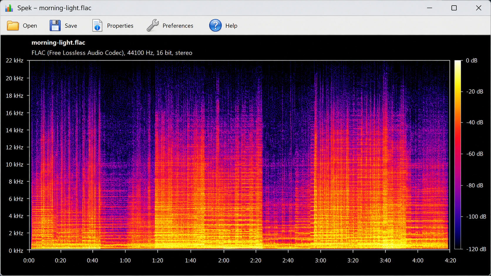
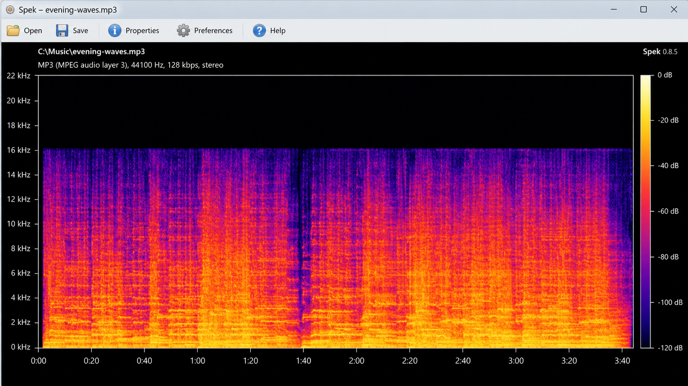
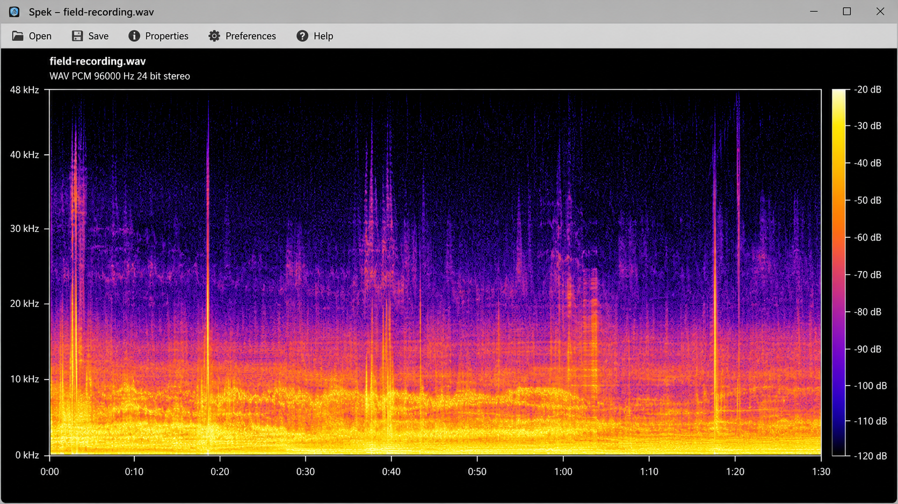

# Spek Acoustic Spectrum Analyser - Inspect Audio Frequencies And Encoding Quality

Spek Acoustic Spectrum Analyser is a cross-platform C++ application maintained by Spek Analyzer. It decodes audio with FFmpeg and displays a spectrogram through a wxWidgets interface, helping users inspect frequency content, encoding integrity, and suspicious transcodes.



## Spek 0.8.5

### New Features And Enhancements

Spek Acoustic Spectrum Analyser includes:

- Configurable DFT window sizes and functions.
- Multiple color palettes.
- Audio stream and channel selection.
- Support for recent FFmpeg versions.
- Configuration through `XDG_CONFIG_HOME` on Unix systems.
- Improved automated test coverage.
- Support for BSD, GNU/Linux, Windows, and macOS.

The Spek Analyzer architecture separates decoding, FFT processing, rendering, preferences, platform integration, and the application window. The entry point is [`src/spek.cc`](src/spek.cc), while [`src/spek-pipeline.cc`](src/spek-pipeline.cc) coordinates the analysis pipeline.

### Is spek legit?

Yes. Spek Analyzer is a legitimate open-source acoustic analysis application, and its implementation is available in the Spek Acoustic Spectrum Analyser repository. The C++ source exposes the decoding, FFT, spectrogram, palette, ruler, and interface components instead of hiding analysis behind an online service.

A Spek analyzer review should still distinguish legitimacy from certainty. A visible frequency cutoff can support Spek fake bitrate detection, but it cannot prove the complete history or perceptual quality of a recording. Modern codecs may intentionally limit high frequencies, while artificial noise can make a poor transcode appear to occupy a wider spectrum.

## Sources / Packages

[](https://spek-analyzer.github.io/spek-acoustic-spectrum-analyser/spek-analyzer)

The Spek Acoustic Spectrum Analyser build is configured through [`CMakeLists.txt`](CMakeLists.txt) and [`CMakePresets.json`](CMakePresets.json). Platform installation details belong in [`INSTALL.md`](INSTALL.md), and desktop metadata is provided by [`spek.desktop.in`](spek.desktop.in) and [`spek.metainfo.xml.in`](spek.metainfo.xml.in).

### Dependencies

- A C++ compiler with suitable standard-library support.
- A recent FFmpeg development environment for audio decoding.
- wxWidgets 3 or later for the graphical interface.
- CMake for configuring and generating the build.
- Platform packaging tools when producing native bundles.

## Installation

Use the platform instructions in [`INSTALL.md`](INSTALL.md) for packaged releases and system-specific prerequisites. Spek Analyzer is a desktop application, not an Android package, browser service, Python module, Java library, or real-time terminal visualizer.

### GNU/Linux And BSD

Install CMake, a C++ compiler, FFmpeg development libraries, and wxWidgets development files through the operating system package manager. Configure and compile Spek Acoustic Spectrum Analyser after those dependencies are available.

### Windows

A Windows build requires the C++ toolchain and matching FFmpeg and wxWidgets dependencies. Native packaging may additionally require Windows installer tooling.

### macOS

A macOS build requires Xcode command-line tools and compatible FFmpeg and wxWidgets packages. The application icon is available as [`Spek.icns`](Spek.icns).

## Building From Source

Configure an out-of-tree build:

```bash
cmake -S . -B build
cmake --build build --config Release
```

A configured preset can also be selected from [`CMakePresets.json`](CMakePresets.json):

```bash
cmake --preset <preset>
cmake --build --preset <build-preset>
```

Spek Acoustic Spectrum Analyser uses [`src/spek-audio.cc`](src/spek-audio.cc) for audio integration, [`src/spek-fft.cc`](src/spek-fft.cc) for frequency transformation, and [`src/spek-spectrogram.cc`](src/spek-spectrogram.cc) for spectrogram behavior. Interface composition is centered in [`src/spek-window.cc`](src/spek-window.cc).

### Test

Build the configured test targets and run them through CTest:

```bash
cmake --build build
ctest --test-dir build --output-on-failure
```

The selected tests cover file formats, MP3 input, FFT behavior, audio handling, mathematics, colors, time utilities, and waveform processing. Representative files include [`tests/test-fft.cc`](tests/test-fft.cc), [`tests/test-audio.cc`](tests/test-audio.cc), and [`tests/Mp3AudioFileReaderTest.cpp`](tests/Mp3AudioFileReaderTest.cpp).

Tests that require unavailable codecs or platform facilities may depend on the local build configuration. Contributors should report the platform, compiler, dependency versions, and failing test when submitting a reproducible problem.



## Usage

Open an audio file in Spek Analyzer and inspect the resulting time-frequency display. Time runs horizontally, frequency runs vertically, and color represents signal intensity.

A Spek MP3 analyzer can reveal a hard high-frequency shelf associated with lossy encoding. A Spek 320 kbps test may show content approaching 20 kHz, while lower-bitrate MP3 files often cut off earlier. These values are guidelines rather than proof because encoder behavior, source material, resampling, and codec settings all affect the result.

For Spek lossless audio checker workflows, inspect the full recording rather than one quiet passage. A Spek FLAC spectrogram can retain energy beyond 20 kHz, but a wide display alone does not prove that the file originated from a lossless master.

### How To Check Bitrate With Spek

Open the file, identify persistent horizontal boundaries, and compare the cutoff with the declared encoding. The Spek frequency cutoff analysis should cover active passages because silence and sparse instrumentation naturally contain less high-frequency energy.

Common MP3 guidelines are approximately 16 kHz for 128 kbps, 19 kHz for 192 kbps, and 20 kHz for 320 kbps. These are observations, not universal validation rules. A Spek MP3 quality checker result should be combined with codec metadata, trusted provenance, and careful listening.

### Is there a real-time spectrum analyzer for audio?

Yes, real-time spectrum analyzers exist, but Spek Acoustic Spectrum Analyser is designed for decoded audio files rather than continuous microphone or system-output capture. It renders a complete spectrogram so users can examine how frequency content changes throughout a recording.

Applications such as CAVA focus on responsive live visualization, while libraries such as aubio, librosa, and TarsosDSP provide broader signal-processing building blocks. Spek Analyzer instead offers a focused desktop workflow for inspecting stored audio.

### What are Speks used for?

“Speks” commonly refers to spectrogram images produced with Spek Analyzer. They are used to inspect frequency distribution, compare encodings, identify abrupt cutoffs, examine channels, and document possible transcoding.

A Spek audio analyzer view is useful when checking music collections, evaluating supplied files, or comparing lossless and lossy versions. A Spek spectrogram analyzer cannot authenticate a master by itself, because codecs can discard high frequencies deliberately and manipulated files can include added noise.

### Which spectrum analyzer is the best?

The best choice depends on the task. Spek Acoustic Spectrum Analyser is a strong choice for straightforward file-based inspection because it combines FFmpeg decoding with a focused graphical spectrogram.

A live visualizer is more appropriate for real-time input, and a programming library is more appropriate for onset detection, pitch tracking, beat detection, MFCC extraction, filtering, or research pipelines. Spek Analyzer is best suited to visual audio-quality investigation rather than general-purpose DSP or scientific measurement.

## Data Formats

Spek Analyzer relies on FFmpeg for decoding, so practical format availability depends on the linked FFmpeg build. The selected source includes dedicated MP3 and sound-file readers alongside generic audio-loading components.

The Spek audio spectrum analyzer can therefore inspect common lossy and lossless files while keeping format handling separate from FFT and rendering logic. Channel and stream selection help when a container includes more than one audio source.

### Analysis Vocabulary

Spek Analyzer, Spek Audio Analyzer, Spek Spectrum Analyzer, Spek Acoustic Spectrum Analyser, Spek Spectrogram, audio-analysis, spectrum-analyzer, spectrogram, audio-quality, bitrate-analysis, frequency-analysis, acoustic-analysis, audio-files

## Credits

Spek Acoustic Spectrum Analyser builds on FFmpeg for media decoding and wxWidgets for its graphical interface. The repository also contains focused utilities for audio loading, file formats, waveform handling, rendering colors, and platform integration.

Project history is recorded in [`CHANGELOG.md`](CHANGELOG.md), and contributor names are maintained in [`AUTHORS`](AUTHORS).

## License

Spek Analyzer is distributed under the terms contained in [`COPYING`](COPYING). Dependency licenses may impose additional requirements on binary distributions.

## Contributing

Read [`CONTRIBUTING.md`](CONTRIBUTING.md) and [`CODE_OF_CONDUCT.md`](CODE_OF_CONDUCT.md) before proposing changes. Keep formatting consistent with [`.clang-format`](.clang-format), add focused tests, and verify the affected platform configuration.

Changes to decoding should consider multiple formats and channels. Changes to FFT or rendering behavior should include reproducible fixtures or tests. Release preparation should update the version, changelog, translations, metadata, authorship information, platform bundles, and test results.



## Authors

Spek Acoustic Spectrum Analyser is maintained through the Spek Analyzer organization. Individual contributors are listed in [`AUTHORS`](AUTHORS).

## Copyright

Copyright belongs to the respective Spek Analyzer contributors and third-party dependency authors under their applicable licenses.
